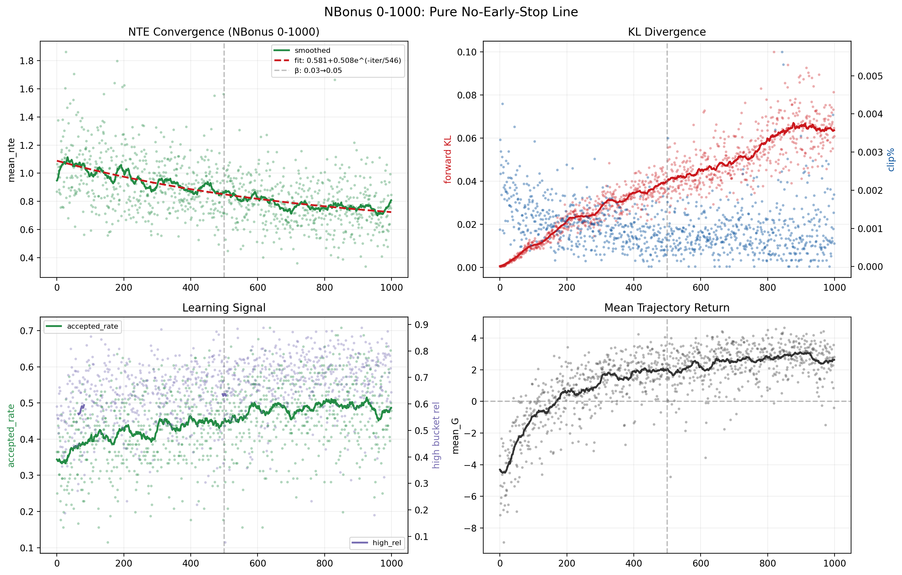
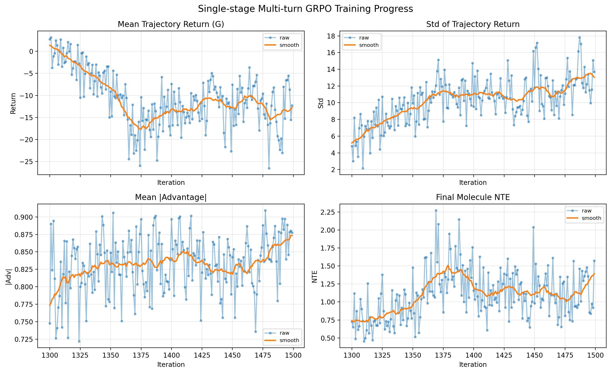
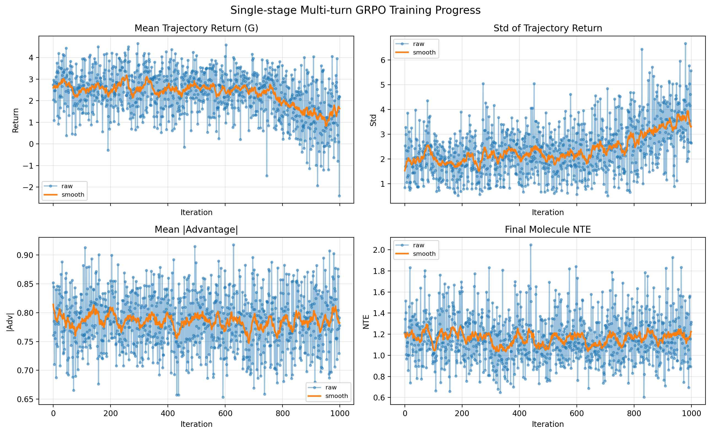

# Fragment-Level Molecular Optimization with LLM Post-Training

**Multi-turn GRPO post-training of an Analyse–Plan–Edit–Verify molecular editing agent over BRICS fragments**

*Research project under the supervision of Prof. Bang Liu, Université de Montréal / Mila — LLM post-training, RLHF & reasoning.*

This repository contains the full pipeline and experiments for post-training a large language model
(Qwen3-8B, LoRA) to perform **multi-objective molecular optimization** through iterative,
fragment-level edits — rather than one-shot SMILES regeneration. The model is trained with
**multi-turn GRPO** on the Tinker RL platform using a composite reward over edit validity,
property alignment (QED, LogP, molecular weight, HOMO/LUMO), structural safety, and edit efficiency.

## TL;DR

- **4,200-example dataset** ([dataset/](dataset/)) that decomposes molecular optimization into four labeled steps — property **A**nalyse, edit **P**lan, fragment **E**dit, and **V**erify — with hindsight-bias filtering so the plan cannot leak the gold answer.
- **Structured fragment editing**: molecules are represented as locally editable **BRICS fragments**; the model acts through `Replace` / `Add` / `Remove` operations, validated by RDKit and rolled back whenever an edit hurts the objective.
- **Multi-turn GRPO post-training** of Qwen3-8B (LoRA rank 32): group-normalized advantages, PPO + forward-KL regularization (β=0.03), composite reward over format, property improvement, repetition, and early stopping.
- **Generalization results** (100 unseen targets × 10 trials, best-of-10): initial NTE 3.65 → best NTE **1.01** (mean), **99/100 targets improved and 0/100 worsened**; a 3D-descriptor-augmented variant reaches mean best NTE **0.861**.
- **Systematic debugging of training instability** — reward saturation, KL drift, advantage collapse — documented in [docs/](docs/), the per-experiment READMEs, and [analysis/reward_saturation_diagnostic.py](analysis/reward_saturation_diagnostic.py).

## Background & Motivation

Multi-objective molecular optimization (simultaneously moving QED, LogP, molecular weight, or
HOMO/LUMO energies toward target values) is a cornerstone of drug-discovery workflows.
Two design choices set this project apart:

1. **Fragment-level editing instead of one-shot generation.** Instead of regenerating a whole SMILES string, the molecule is decomposed into BRICS fragments and the model edits *one fragment per turn*. This makes edits (a) chemically interpretable, (b) locally constrained, and (c) reversible — an edit that worsens the objective is rejected and rolled back, so every trajectory is monotonically safe.
2. **A reasoning-style workflow as the RL testbed.** Each turn must emit a four-block chain (`<ANALYSE>` → `<PLAN>` → `<EDIT>` → `<VERIFY>`), making the task a constrained, verifiable proxy for "reasoning under RL post-training": the reward is dense, computable, and decomposable per component.

## Method

### Molecule representation and structured edits

- Molecules are decomposed with RDKit **BRICS**; fragments are cleaned (dummy `*` atoms stripped) and injected into the prompt together with the current SMILES.
- Each turn, the model emits exactly one of three structured actions:
  - `Replace <fragment A> with <fragment B> to form <SMILES>…</SMILES>`
  - `Add …` / `Remove …`
- The produced SMILES is validated with RDKit, its properties are computed, and the edit is **accepted only if NTE decreases**; otherwise the state is rolled back and feedback is injected (accept/reject + rollback guarantees no trajectory ends worse than where it started).

### Analyse–Plan–Edit–Verify workflow

Each generated turn must follow the four labeled blocks in order:

```
<ANALYSE>   current molecule, fragments, current properties, requested changes
<PLAN>      Reasoning / Proposed edit / Expected effect (structured schema)
<EDIT>      the single fragment-level action
<VERIFY>    expected property changes of the edited molecule
```

The `<PLAN>` block uses a structured three-line schema (`reasoning_proposed_intent_expected_v2`),
and dataset filtering removes plans that reference the gold answer (hindsight bias).

### Evaluation metric: NTE

The **Normalized Total Error** aggregates distance to target across properties:

```
NTE = |ΔQED|/0.5 + |ΔLogP|/3.0 + |ΔMW|/50.0        (QED/LogP/MW task)
NTE = |ΔHOMO| + |ΔLUMO|   (eV)                     (HOMO/LUMO task)
```

where Δ is the gap between the current molecule's property and the target value.

### Composite per-turn reward

```
r_turn = r_fmt + r_prop + r_rep + r_early_stop

r_fmt     +1.0 for well-formed output, −10.0 for malformed output
r_prop    −5.0 for invalid molecules;
          2.0·Δ_clip + 0.5·Q for valid molecules, where
              Δ_rel  = (NTE_old − NTE_new) / max(NTE_old, 1e−6)   # relative improvement
              Δ_clip = clip(Δ_rel, −4, 1)
              Q      = 1 − clip(NTE_new / 2, 0, 1)                # absolute quality
r_rep     −0.1 × (# duplicate canonical SMILES in the group − 1)  # structural-similarity / repeated-edit penalty
r_early   +2.0 and episode termination when NTE ≤ 0.25 × initial NTE
```

A single unified formula is applied to *all* valid molecules (improving or not) so the reward
carries a continuous gradient signal, while the rollback mechanism independently guarantees safety.

### Multi-turn GRPO training

- **Group sampling**: K=8 parallel trajectories per prompt, up to T=3 edit turns, discount γ=1.1 (later, finer edits weight more). Group return `G = Σ γ^t · r_turn`, advantage = group-normalized `(G − μ_G)/σ_G`; groups with σ_G < 1e−8 get **all-zero advantages and are dropped** (an EMA-fallback alternative was found to introduce bias — see [2D-qed-logp-mw/README.md](experiments/2D-qed-logp-mw/README.md)).
- **PPO + forward-KL loss**: `L = L_PPO + β·KL`, clip range [0.8, 1.2], β=0.03; the KL reference is **frozen at the SFT checkpoint** across all training segments to prevent reference drift.
- **Schedule**: LR warmup 5e−6 → 5e−5 (0–1000 iters), hold, cosine decay to 1e−6 by 25k iters; Adam with grad-clip 1.0; sampling refresh every 4 iterations.
- Base model **Qwen3-8B** with **LoRA rank 32**, trained on the **Tinker** RL platform (weights and training service live on the platform; checkpoints are referenced by `tinker://` URIs).

## Dataset Construction

The 4,200-example dataset (4,000 train + 200 val) is built from the
`Alan123/qa_dataset_with_qed_logp_mw_grpo` corpus (~163k prompts):

1. Prompts with parseable `<QED>/<LogP>/<MW> higher|lower` target tags are sampled.
2. Each prompt is decomposed into the four-step Analyse–Plan–Edit–Verify chain by an LLM.
3. Plans are filtered against hindsight-bias patterns (regex list in
   [dataset/dataset_constuction_v2.py](dataset/dataset_constuction_v2.py)) so the plan cannot
   reference the gold edit.
4. Tolerances: QED 0.02, LogP 0.20, MW 5.0; generation is resumable with checkpoints every 500 examples.

The final artifact and the full schema are documented in [dataset/README.md](dataset/README.md).
A 50-example preview is available at
[dataset/fourstep_qed_logp_mw_sft_train_v2_intent_50.jsonl](dataset/fourstep_qed_logp_mw_sft_train_v2_intent_50.jsonl).

## Experiments

| Directory | Task | Properties | Reward / variant | Status | Key result |
|---|---|---|---|---|---|
| [2D-qed-logp-mw](experiments/2D-qed-logp-mw/) | primary | QED, LogP, MW | delta-NTE + absolute quality, turn-2 bonus, KL β=0.03, early-stop | trained 0→1500 iters; gen test at iter 1000 | best NTE 1.01 (from 3.65); 99/100 improved, 0/100 worsened; turn validity 93.7% |
| [2D-deltaNTE](experiments/2D-deltaNTE/) | QED/LogP/MW | delta-NTE | implicit vs explicit-KL pilots, layer/LR ablations | trained to ~12k iters; gen test at 11k | best NTE 1.160; validity 96.5%, acceptance 96.5% |
| [2D-homo-lumo](experiments/2D-homo-lumo/) | HOMO/LUMO (eV) | soft-gated reward, Q-cap 5.0 | HOMO/LUMO NTE variant | trained 0→1000; no gen test yet | training stable over 0–1000 |
| [2D-deltaNTE-homolumo](experiments/2D-deltaNTE-homolumo/) | HOMO/LUMO scaffold | delta-NTE | prepared with `analyze_homo_lumo.py` | no runs yet | — |
| [3D-desc](experiments/3D-desc/) | QED/LogP/MW | 3D descriptors (quantile buckets) injected into prompts | AUX-3D ablation, mini-validity-signal variant | trained to 3000 iters, kl=0.2 | no gen test |
| [3DDESC-qed-logp-mw](experiments/3DDESC-qed-logp-mw/) | QED/LogP/MW | 3D descriptors (none/size/shape/surface/all) | 3D-prompt ablation | trained 0→1300; gen tests at 1000 & 1300 | **best NTE 0.940 → 0.861** (best overall) |

Each experiment directory is self-contained (RL core, training entry, dataset/model/metrics/plotting
modules, generalization test, unit tests) and has its own README (in Chinese) with full method and
command details.

## Results

### Training dynamics (primary experiment, 0–1000 iters)

Mean NTE falls from **1.08 → 0.76**, acceptance rate rises 38% → 49%, and turn validity
85% → 97% ("grammar graduates" early, after which RL teaches strategy):



Late-stage progress (1300–1500 iters) and long-run stability (12k iters, 2D-deltaNTE):




### Generalization protocol

100 unseen (QED, LogP, MW) target tuples × 10 independent trials × up to 3 edit turns,
best-of-10 reported, identical sampling pipeline to training (full configs and aggregates in
[docs/results/](docs/results/)).

| Metric | 2D-qed-logp-mw (iter 1000) | 2D-deltaNTE (iter 11k) | 3DDESC (iter 1000 → 1300) |
|---|---|---|---|
| Initial NTE (mean) | 3.652 | — | — |
| Best NTE (mean) | **1.014** | 1.160 | 0.940 → **0.861** |
| Relative improvement | 67.9% | — | — |
| Targets improved / worsened | 99 / 0 | — | — |
| Turn validity rate | 93.7% | 96.5% | — |
| Turn acceptance rate | 54.6% | 96.5% | — |

Property-level analysis of the primary run: MW is the easiest property (median 93% relative
improvement — fragment edits change it directly), LogP is the bottleneck (47.2% of residual NTE —
it is highly sensitive to local group changes), and **0/100 targets meet all three tolerances
simultaneously** — exact three-property hits remain chemically hard, though NTE shows the model
consistently moves in the right direction.

Additional figures (reward decomposition, property errors, per-bucket improvement) are in
[docs/results/](docs/results/), and the raw per-target trials live under each experiment's
`generalization_test_results/`.

## Repository Structure

```
AI4Materials/
├── dataset/                       # 4,200-example dataset construction pipeline + final artifacts
│   ├── dataset_constuction.py     #   base builder (BRICS fragments, 4-step chain, resumable)
│   ├── dataset_constuction_v2.py  #   structured PLAN schema + hindsight-bias filtering
│   ├── rewrite_plan_dataset.py    #   regenerate only <PLAN> blocks
│   ├── visualize_fourstep_dataset.py
│   └── fourstep_*_4000/200/50.jsonl  # train/val/preview artifacts (see dataset/README.md)
├── experiments/                   # one self-contained directory per experiment (see table above)
├── analysis/                      # cross-experiment training metrics & plotting scripts
├── notebooks/
│   ├── tinker_sft_grpo_tutorial.ipynb            # SFT + GRPO on the Tinker platform (tutorial)
│   ├── multistep_rl_fourstep_dataset.ipynb       # multi-turn RL experiments on the 4-step dataset
│   └── legacy/                                    # early exploration notebooks (pre-APEV pipelines)
├── docs/
│   ├── results/                   # selected evidence figures + generalization summaries
│   ├── four_step_experiment_plan.md               # full experiment plan (Chinese)
│   └── 蒸馏.md                     # distillation notes (Chinese)
├── run_v2_phase1_4000.fish        # regenerate the dataset end-to-end
├── requirements.txt
└── README.md
```

## Setup & Usage

```bash
python -m venv .venv && source .venv/bin/activate
pip install -r requirements.txt
```

The RL training runs on the **Tinker platform** (external service; account + `TINKER_API_KEY`
required). Model weights, LoRA adapters, and training jobs live on the platform — checkpoints are
referenced by `tinker://` URIs, so no weights are stored in this repo. The `tinker` and
`tinker-cookbook` pip packages provide the client; the cookbook repo
(Thinking Machines Lab's `tinker-cookbook`) documents the platform API.

- **Dataset**: the final artifacts are committed under [dataset/](dataset/); to regenerate, run
  `./run_v2_phase1_4000.fish` from the repo root (LLM-served decomposition, ~resumable over hours).
- **Training**: each experiment dir exposes `train_grpo_*.py`; full segmented-training commands
  (KL ref frozen at SFT checkpoint, per-segment seeds) are in
  [experiments/2D-qed-logp-mw/README.md](experiments/2D-qed-logp-mw/README.md).
- **Evaluation**: `python experiments/<exp>/generalization_test.py --checkpoint tinker://…`
  runs the 100×10 generalization protocol.
- **Analysis**: scripts in [analysis/](analysis/) aggregate `out/training_metrics/` across
  experiments (run from the repo root).

## Limitations & Lessons

*Lessons from reward/trajectory design and training-instability investigations during this project.*

Verified design fixes adopted over successive runs ([2D-qed-logp-mw/README.md](experiments/2D-qed-logp-mw/README.md)):

- Bucketed rewards and milestone bonuses were removed in favor of one unified continuous formula; a flat invalid-molecule penalty was replaced by a formula that preserves gradient information.
- GRPO groups with σ_G ≈ 0 get all-zero advantages and are dropped (EMA fallback introduced bias).
- γ was raised from 0.85 to 1.1 — early turns carry less weight, later precise edits more.
- The KL reference is frozen at the SFT checkpoint to prevent reference drift; forward-KL is monitored as a policy-drift indicator (0.07–0.12 = watch ρ_mean and format degeneration, > 0.15 = risk of forgetting).
- A `reward_saturation_diagnostic.py` harness samples checkpoints and decomposes reward components to detect saturation early.

Known limitations:

- 0/100 generalization targets meet all three property tolerances simultaneously (LogP is the bottleneck); HOMO/LUMO and 3D-descriptor variants have not yet reached a full generalization run.
- All results are single-checkpoint evaluations on one 100-target split; no multi-seed RL runs yet.

**The failed early runs behind these fixes** (first-person account, condensed from the project diary):

My first multi-turn GRPO runs plateaued around iteration 800: the group-return standard deviation
σ_G collapsed and every tracked metric went flat. Raising the property-reward weight in a later
stage and growing the group size from 4 to 12 both failed to move anything, which pointed away
from the GRPO algorithm itself and toward the reward signal. A saturation diagnostic confirmed it:
the property reward was so compressed that candidates within a sampled group often received
identical values, so the group-normalized advantage carried almost no ranking information.
The fix was to change what the reward *means* rather than its weight — format became a hard gate,
and the property term became a relative delta `clip(old_error − new_error, −5, 5) + 0.2·direction_score`,
widening the spread to roughly [−5.2, 5.2]. Training was restarted from checkpoint 700 instead of
continuing from 800, since the output distribution had already narrowed. The same diagnosis repeated
one level up: an over-dominant format reward was teaching the model to *write in the APEV format*
rather than *improve the molecule*, which motivated the final unified continuous formula (format as
penalty, property as gradient, rollback as safety). Later stability fixes followed the same
evidence-first pattern: the EMA fallback for zero-σ_G groups was dropped after showing bias, the KL
reference was frozen to the SFT checkpoint after drift was observed across segments, and a global
segmented LR schedule replaced per-segment warmup.

## References

- Degen, Wegscheid-Gerlach, Zaliani, Gasteiger (2008). *On the Art of Compiling and Using 'Drug-Like' Chemical Fragment Spaces* (BRICS). ChemMedChem 3(10).
- Shao et al. (2024). *DeepSeekMath: Pushing the Limits of Mathematical Reasoning in Open Language Models* (GRPO).
- Qwen Team (2025). *Qwen3 Technical Report*.
- Hu et al. (2021). *LoRA: Low-Rank Adaptation of Large Language Models*.
- RDKit: open-source cheminformatics toolkit.
- Tinker: RL/SFT platform by Thinking Machines Lab (external service; see Setup).

## Acknowledgements

Advisor: Prof. Bang Liu (Université de Montréal / Mila). This project builds on the Tinker
platform, the `Alan123/qa_dataset_with_qed_logp_mw_grpo` dataset, and the QuantumDeepField
HOMO/LUMO prediction model (external dependencies, not vendored in this repo).
